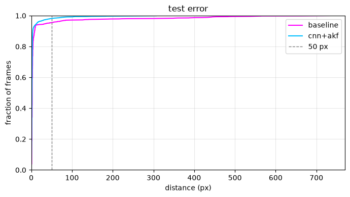
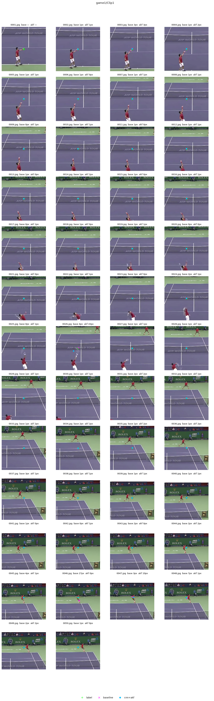
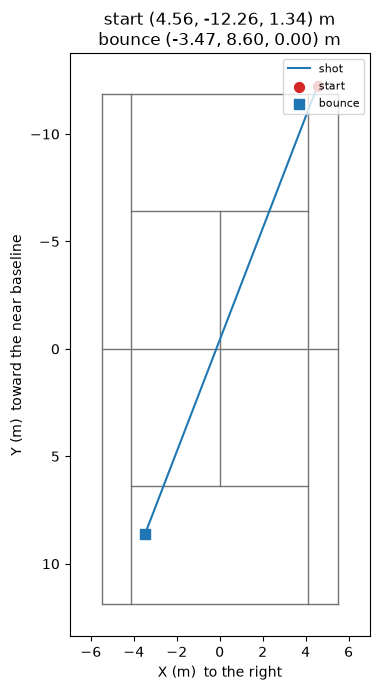
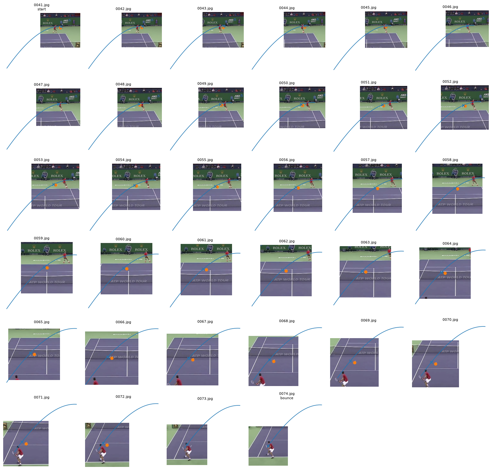

# Horus

An efficient, real-time tennis ball tracking system inspired by principles of human visual perception.

Horus explores how motion-sensitive perception and predictive attention can improve the efficiency and accuracy of high-speed tennis ball tracking. It combines frame differencing to emphasize moving objects with state-space model (SSM) tracking to predict the ball's location and uncertainty, guiding the detector toward localized regions of interest rather than repeatedly processing the entire frame. The goal is to maintain accurate, continuous tracking while reducing unnecessary computation.
The walkthrough is two notebooks:

- [notebooks/efficiency.ipynb](notebooks/efficiency.ipynb) compares cost and accuracy on the test game.
- [notebooks/shot_metrics.ipynb](notebooks/shot_metrics.ipynb) draws the fitted shots for one calibrated clip.

## Efficient tracker vs the baseline

The baseline for the experiment is a TrackNet-style U-Net ([models/baseline_cnn/model.py](models/baseline_cnn/model.py)). Every frame it sees six consecutive RGB frames at 640×360 and returns a heatmap. This model has 11.3 million parameters, and one forward uses 350.65 G FLOPs.

The efficient tracker "Horus" ([tracking/efficient/model.py](tracking/efficient/model.py)) runs a 119k-parameter lightweight CNN on frame-differenced crops of various sizes. Crop placement and size are driven by an adaptive Kalman filter (AKF) in [tracking/ssm/base_akf/model.py](tracking/ssm/base_akf/model.py). The filter state is image-plane position and velocity, `[x, y, vx, vy]`, under a constant-velocity motion model. Each frame it predicts the next location and covariance, forms an uncertainty gate around that prediction, and asks the crop CNN for a measurement there. When the peak is weak, the crop expands and the model is rerun until confidence is high enough or the frame-size limit is reached; in the latter case the tracker falls back to the full-frame baseline. A successful peak updates the state; a miss leaves the prediction in place, grows the covariance, and widens the next search. The "adaptive" part scales process noise from the innovation: large measurement residuals raise the noise so the filter can follow abrupt changes (hits, bounces), and calm residuals pull it back down.

The approach is inspired by two principles of visual perception: **motion sensitivity and predictive attention**. Motion cues help identify moving objects against a largely stationary background, while predictive tracking concentrates processing near the ball's expected location. When confidence decreases, Horus progressively expands its search region, returning to full-frame detection when necessary. This allows the system to allocate computation according to tracking uncertainty rather than processing the entire scene at every frame.

Scored on the **test** game (game10), on the 2,044 labeled frames where both systems already have a position. Distance is source pixels on the 1280×720 frame. Time starts after the frames are in memory. The saved run is CUDA.

| | mean px | median px | over 50 px | params | FLOPs mean | ms mean | ms p95 |
|---|---:|---:|---:|---:|---:|---:|---:|
| Baseline, every frame | 14.6 | 2.2 | 4.5% | 11,334,017 | 350.65 G | 17.34 | 17.60 |
| Hybrid | 4.8 | 1.5 | 1.9% | 11,452,786 | 62.79 G | 6.90 | 56.07 |

Mean hybrid cost is about 5.6× lower, and the mean error is lower. A 30 fps frame is 33.3 ms. The hybrid mean is 6.90 ms. The p95 is 56.07 ms, past that budget, because a baseline call runs both networks (p95 FLOPs 510 G). On this run the baseline was called on 13.9% of frames: 13.90 G from the crop CNN, 48.89 G from those baseline calls, and about 0.5 K from the filter. One isolated forward is 16.52 ms for the baseline and 0.40 ms for a 48 px crop (128.80 M FLOPs).

On hits the hybrid mean is 19.3 px and the baseline mean is 80.3 px. On bounces the hybrid mean is 8.2 px and the baseline mean is 5.6 px. On hard-to-see frames the hybrid mean is 12.0 px and the baseline mean is 77.0 px.

On the held-out test game, Horus reduced mean computational cost by **82%** and mean inference latency by **60%** relative to the full-frame baseline, while reducing mean localization error from **14.6 px to 4.8 px**. The largest accuracy improvements occurred around hits and difficult-to-observe frames, suggesting that temporal state estimation and adaptive search can improve robustness while substantially reducing average computation. However, occasional full-frame fallback calls produce latency spikes that exceed the 30 FPS per-frame budget.





game1/Clip1 is inside the train split. It is a close look at the same hybrid setup, not a held-out score. The full tables, the ablation, and the per-frame distances are in [notebooks/efficiency.ipynb](notebooks/efficiency.ipynb).

## Shot metrics

[notebooks/shot_metrics.ipynb](notebooks/shot_metrics.ipynb) is a demonstration of the current fits on one clip, game1/Clip1, using the landmarks in [trajectories/game1_landmarks.yaml](trajectories/game1_landmarks.yaml). The efficient tracker supplies the image track. A smoothed court-plane track cuts hits and bounces. Each shot is fit with the `RULES` block at the top of that notebook (drag, bounce on the ground, contact height, bounce speed kept), and the printed path is that same model played forward. Bounce `(X, Y)` is taken from the ground-plane homography of the bounce pixel.

The figures are shot 2, frames 0041.jpg–0074.jpg: 59.6 mph, contact at 1.34 m, apex 2.18 m, 1.11 m of clearance over the tape, landing in the singles court. Pixel RMSE on that flight is 19.4 px. Speed is mph. Heights and clearance are meters. A negative clearance would hit the tape.





## Layout

```text
tracking/efficient/          hybrid tracker
tracking/ssm/base_akf/       adaptive Kalman filter
models/baseline_cnn/         full-frame U-Net
models/detection/cnn_detector/   crop U-Net
trajectories/                court, camera, flight fit, shot metrics
notebooks/efficiency.ipynb   cost and accuracy
notebooks/shot_metrics.ipynb one-clip shot figures
notebooks/experiments/       earlier detector, filter, and flight checks
configs/                     dataset splits and training settings
```

## Data

Frames are the [TrackNet](https://nol.cs.nctu.edu.tw/ythuang/epapers/ICIP18_TrackNet.pdf) tennis set, 1280×720 at 30 fps. Place them at `data/Dataset/` (gitignored):

```text
data/Dataset/
  game1/Clip1/0000.jpg … Label.csv
  …
  game10/…
```

Each `Label.csv` has `file name`, `visibility`, `x-coordinate`, `y-coordinate`, `status`.

| Split | Games |
|---|---|
| train | game1–game7 |
| val | game8–game9 |
| test | game10 |

Checkpoints under `saved_models/` are gitignored. The notebooks load:

- `models/baseline_cnn/saved_models/baseline_cnn_train1/baseline_cnn_train1.pt`
- `models/detection/cnn_detector/saved_models/cnn_detector/cnn_detector.pt`

To train:

```bash
python -m models.baseline_cnn.train
python -m models.detection.cnn_detector.train
```

Each script reads `train.name` from its config and writes `saved_models/<name>/<name>.pt`. The crop config already uses `cnn_detector`. The baseline config currently uses `baseline_cnn_train4_focal`, so a new baseline run writes that name and leaves the `baseline_cnn_train1` checkpoint in place.

## Install

Python 3.10 or newer.

```bash
pip install -e .
```

Dependencies live in [pyproject.toml](pyproject.toml) and are mirrored in [requirements.txt](requirements.txt). Open the notebooks from the repository root. They also run from `notebooks/`, because each one walks up to the directory that contains `configs/`.
